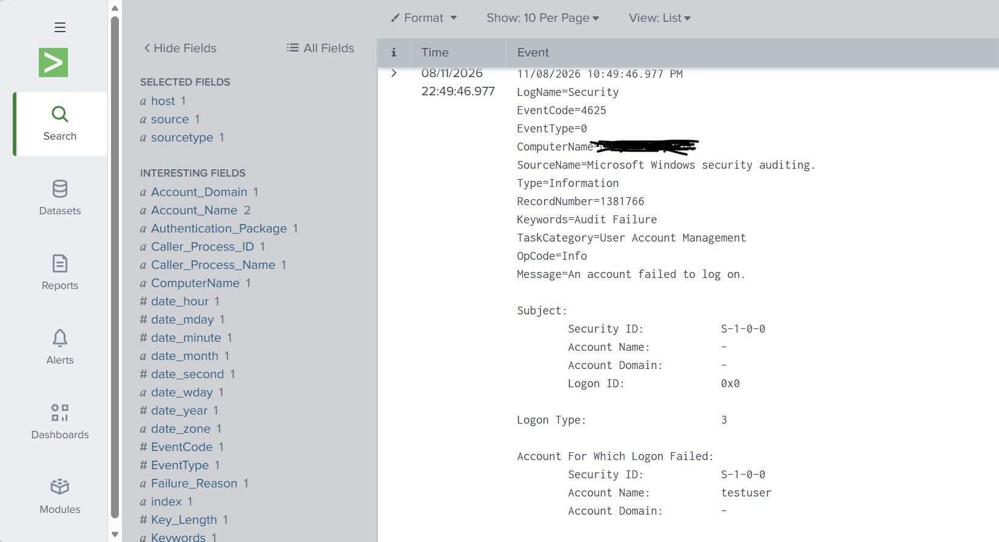
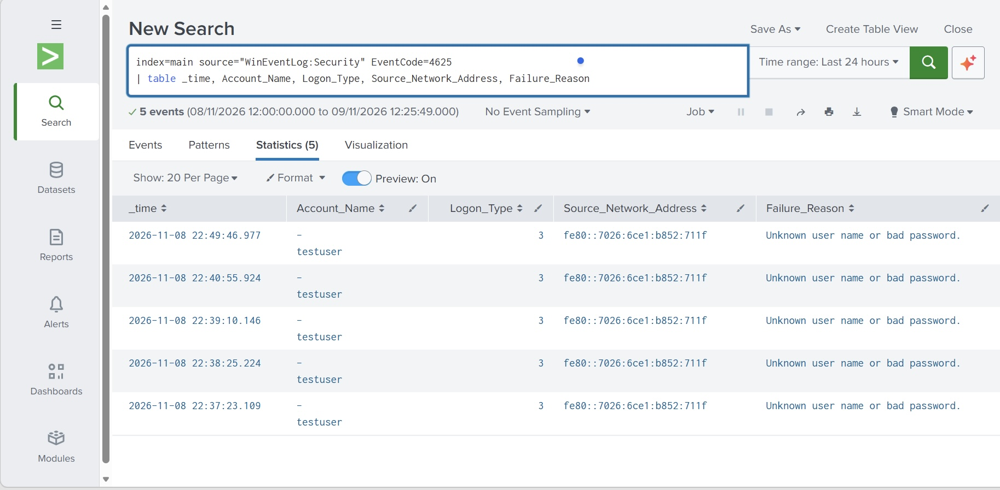
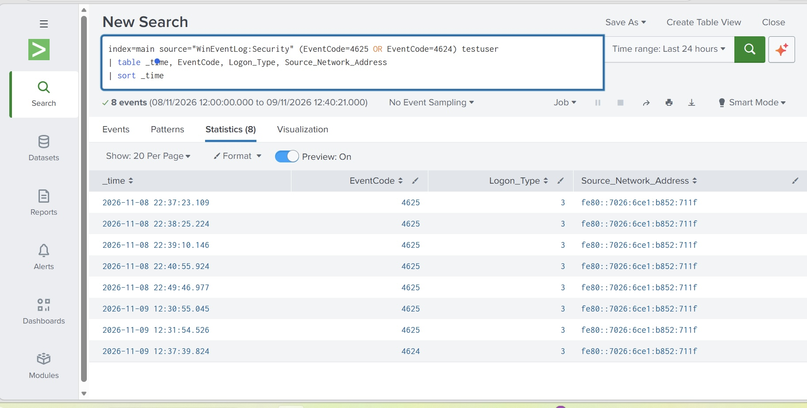
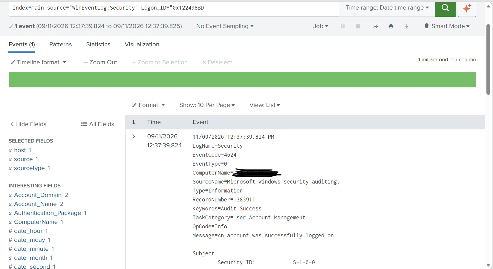
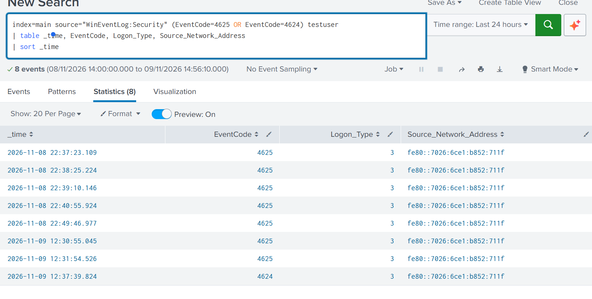
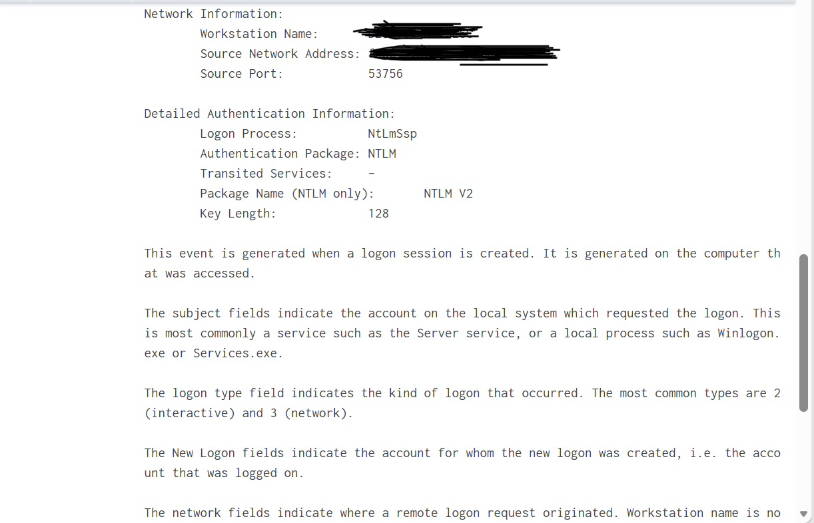
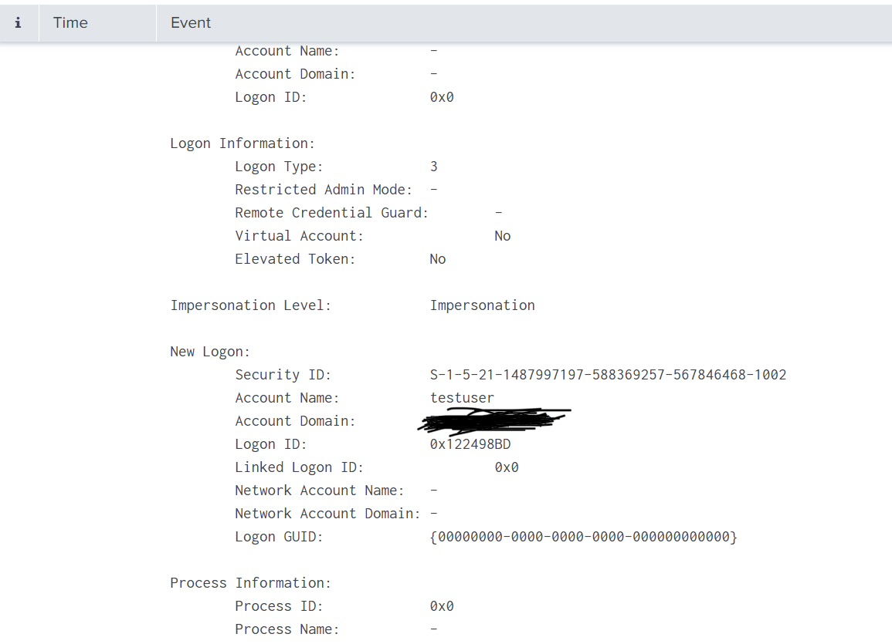
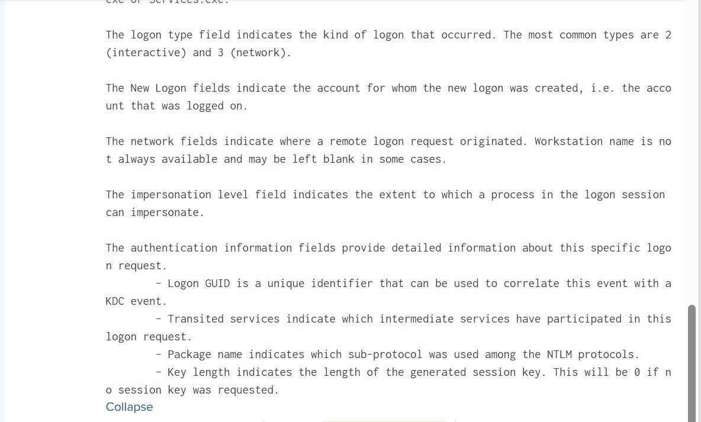

# Alert 01. Repeated failed logons followed by a successful logon

**Source:** Windows Security log from my own PC, ingested into Splunk
**Account:** testuser (local account, created by me)
**Environment:** Splunk Enterprise home lab. I caused the events myself.

## What fired
Seven failed logons (EventCode 4625) for testuser, followed by one
successful logon (EventCode 4624) at 12:37 on 9 November.

## What I checked
1. The timeline of 4625 and 4624 events for the account.
2. The logon type and source address.
3. Whether the account had admin rights.
4. What the session did after the logon, using its Logon ID.

## Evidence

Search used:
index=main source="WinEventLog:Security" (EventCode=4625 OR EventCode=4624) testuser
| table _time, EventCode, Logon_Type, Source_Network_Address
| sort _time

Findings:
- Five failures between 22:37 and 22:49 on 8 November, then two on
  9 November at 12:30 and 12:31, then a success at 12:37.
- Logon type 3 (network), NTLM v2, source address was the machine
  itself (IPv6 link-local), so no outside source.
- Elevated token: No. The account is a local account, not a domain account.
- Searching the Logon ID returned only the logon itself. No later
  activity was recorded.

 ## - Failure Status 0xC000006D, Sub Status 0xC000006A.
 The account exists and the password was wrong, so this was password guessing on a valid account,
    not a search for user names.
  
## Benign explanations
A user mistyping a password and then getting it right. A service or
script using an old stored password. In this case I caused it.

## Verdict
True positive in the lab, because I generated it. In a real
environment I would treat it as suspicious until the account owner
confirmed it.

Weakness in the pattern: the failures are spread over 14 hours, so
this is not a tight brute force burst. Only two failures sit close to
the success.

## Severity
Low to medium. No privileges, no follow-on activity, local source.

## Action
Escalate if the account were privileged, the source address were
unexpected or there was activity after the logon. Otherwise, confirm
with the account owner and close.

## Next steps
Check whether the account is used by a service, alert on 5 or more
failures in 10 minutes followed by a success, and review NTLM use.
